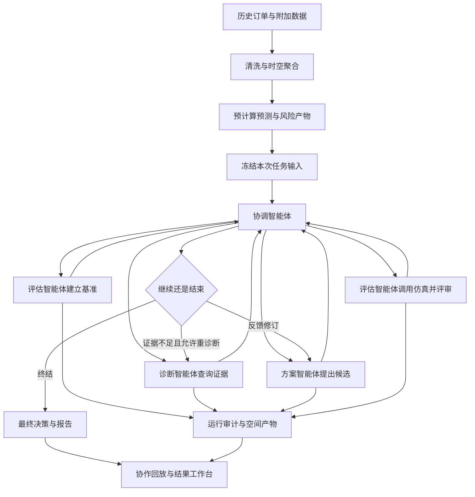

# Phase 7 改造设计：四角色大模型协作与调度决策工作台

> - 版本：v1.0
> - 日期：2026-11-02（Asia/Shanghai）
> - 状态：用户已确认方向 B；本文细化实施设计，尚未实施和验证。
> - 汇报目标：2026-11-03，五分钟，侧重多智能体技术，兼顾业务结果，允许回放真实运行记录。
> - 模型服务：DeepSeek；具体模型、账号能力、调用耗时和可用性待接入验证。

## 0. 设计结论与阅读导航

本次改造将现有分析、预测、仿真与审计能力，组织成以“一次调度任务”为中心的系统。四个角色均由大模型承担实际决策职责；确定性程序执行工具、保存事实、检查约束和控制运行边界。主展示为真实运行记录的交互回放。

优先交付：真实四角色闭环、可读的协作工作台、与所选候选一致的空间结果、可导出的决策报告。高德地图作为增强能力，排在核心闭环和结果一致性之后。PPT 围绕系统实际完成的一次任务组织。

本文不是新增功能已经完成的声明，也不把现有规则运行重新标记为大模型运行。

| 阅读目的 | 对应章节 |
|---|---|
| 了解为什么改、改到什么程度 | 1—3 |
| 理解四个大模型角色如何真正协作 | 4—7 |
| 评审数据、日志、候选与地图的一致性 | 8—10 |
| 评审界面、地图和演示体验 | 11—14 |
| 安排实现、验收和交付 | 15—20 |

## 1. 当前问题与代码基线

### 1.1 用户感受到的问题

1. 数据、图表与日志很多，但看不出本次任务、主要发现、最终产物和结果。
2. 多智能体过程被分散为角色说明、候选表和消息长列表，难以理解角色之间的交接。
3. 地图缺少熟悉的地名和道路语境；网格、数值与具体业务意义脱节。
4. 播放器在播放数据帧，观众却不知道应该关注什么事件。
5. 首页、总览、播放器、工作台和协作页之间没有一条统一的任务主线。
6. 用户预期有大模型参与决策，现有实现实际为规则驱动。

### 1.2 已存在且应复用的能力

以下判断来自本仓库代码与产物检查；本文没有重新执行全量测试或调用模型。

| 当前能力 | 主要位置 | 本次处理 |
|---|---|---|
| 双源订单适配、清洗、网格聚合 | bike_agent/data/、prep/ | 复用，作为任务的预计算数据输入 |
| 预测与风险清单 | bike_agent/forecast/、risk/ | 复用，通过工具提供证据 |
| 规则与约束优化调度仿真 | bike_agent/sim/ | 复用指标公式和业务规则 |
| 四角色上下文与规则决策 | bike_agent/multi_agent/roles.py | 保留规则模式，新增大模型角色实现 |
| 顺序编排与修订闭环 | bike_agent/multi_agent/orchestrator.py | 为大模型模式增加受约束的动作调度 |
| 消息校验与工具权限 | contracts.py、messages.py、gateway.py | 复用机制，新增版本化契约 |
| 每次运行独立审计目录 | bike_agent/multi_agent/audit.py | 扩展模型调用、事件和空间产物 |
| 离线协作页生成 | bike_agent/presentation/collab.py | 提取已有运行发现能力，新增任务视图模型 |
| 本地 HTTP 服务 | bike_agent/serve/app.py | 增加运行记录只读接口；实时执行接口后置 |
| 工作台、预测联动、离线底图 | replay/、bike_agent/presentation/ | 复用数据与绘图逻辑，重构展示组织 |

### 1.3 需要正面解决的技术缺口

- 当前角色是普通 Python 对象，主要判断由规则完成，不能直接称为四个大模型智能体。
- 当前编排器预先调用基准评估、诊断、提案、评估，再按规则协调角色的输出进入修订。仅替换文案不能形成方案 B。
- 当前任务模式只允许 deterministic；协议为 1.0，且 Schema 拒绝额外字段。新增模型字段不能直接塞进旧消息。
- 当前 evaluate_dispatch_candidate 返回汇总指标与逐时轨迹，没有完整逐格状态引用。
- simulate 内部已经产生 cell_states，但 run_simulation 的返回值没有暴露它；write=True 才写到旧的全局回放路径。新运行不能依靠覆盖全局文件保存候选空间结果。
- 现有场景切换只更新汇总表，地图仍为 baseline。新系统必须消除该类语义错位。
- get_risk_ranking 当前不是任意时段的风险查询；不能把它的结果当成关注时段的风险证据。
- 当前诊断没有格级账本工具，预测净流出只能支持“可能相关”，不能证明某格造成了实际损失。
- 当前审计报告有“规则驱动、LLM 未接入”等固定说明，必须按实际运行模式生成。
- 当前评估封装用 get(key, 0) 提取 violations；新路径必须先检查引擎原始字段完整，避免把缺失约束计数误判成零违规。

## 2. 已确认决策、实施假设与范围

### 2.1 已确认

| 编号 | 决策 |
|---|---|
| D7-01 | 选择 B：协调、诊断、方案、评估四个角色均有真实大模型调用和决策职责 |
| D7-02 | 使用 DeepSeek；允许同一模型承担四个具有独立上下文的角色 |
| D7-03 | 以一次调度任务串起输入、协作、候选、空间结果与报告 |
| D7-04 | 演示允许回放真实运行记录，不要求现场等待模型完成 |
| D7-05 | 沿用现有预测、策略集合与仿真引擎 |
| D7-06 | 改造优先级为：真实闭环 → 可读展示与一致结果 → 地图增强 → 汇报材料 |
| D7-07 | 当前只形成设计文档，不实施功能 |

### 2.2 本文采用的实施默认值

以下是为控制范围提出的设计默认值，可在实施前调整，不是用户另外指定的硬要求。

- 主演示使用厦门；上海用于补充验证和附录。
- 核心展示以本地 HTTP 站点运行，同时生成可脱机查看的演示包。
- 新界面使用轻量原生 HTML/CSS/JavaScript 与 SVG，先复用现有 Python 技术栈，不引入复杂前端工程。
- 角色顺序协作，一次只推进一个决策动作；不把多智能体等同于多进程或并行执行。
- 初期保留结构化任务表单；自然语言需求理解作为后续增强。
- 高德为首选在线地图方案；百度为可替代服务商，本期不同时集成两家。
- 规则模式继续可用，并在页面明确标注，作为对照和开发回归入口。

### 2.3 核心交付范围

1. DeepSeek Provider、四角色模型实现、受约束的动作协议。
2. 真实工具调用、证据引用、反馈与修订、明确终态。
3. 模型调用及程序事件可追溯的统一运行记录。
4. 基准和已评估候选的独立空间产物。
5. 任务入口、协作工作台、结果报告三个视图。
6. 真实运行回放、节点点击、候选对比、地图和报告联动。
7. 厦门主演示包、截图、录屏和五分钟讲稿依据。

### 2.4 增强项与后续项

| 优先级 | 内容 | 取舍 |
|---|---|---|
| P1 | 高德底图、地名和道路语境 | 核心完成后接入；失败时保留可用的离线空间视图 |
| P1 | 浏览器创建并执行新任务、实时事件展示 | CLI 真实运行与记录回放先完成 |
| P1 | 补充格级账本只读工具、按时段风险查询 | 可改善诊断证据，须独立定义契约 |
| P1 | 上海完整展示、更多真实模型运行 | 先保证厦门一条完整主线 |
| 后续 | 自然语言自动配置任务、复杂目标权衡 | 不阻塞本次汇报 |
| 后续 | 模型直接输出逐格搬运计划、车辆路径规划 | 会改变动作空间与仿真输入，单独立项 |
| 后续 | 在线运营数据、账号权限、多租户、任务队列平台 | 不纳入本次管理后台外观改造 |

高德虽为 P1，“所选候选的空间结果可查看”属于核心能力，不能一起删去。

## 3. 系统定位与成功标准

### 3.1 对外定位

“面向共享单车调度的多智能体决策原型：四个大模型角色使用预测、风险与仿真工具，在给定策略及搬运预算范围内协作选择可验证的方案，并保留决策证据。”

大模型决定诊断方向、候选组合、评审意见和后续动作；具体搬运记录由所选策略的仿真引擎产生。历史数据、假设库存与容量构成模拟环境，输出不代表已执行的真实运营效果。

### 3.2 观众应该能回答的六个问题

1. 输入是什么，分析哪个城市和时段？
2. 这次任务的目标和约束是什么？
3. 每个智能体实际做了什么决定？
4. 方案为什么被接受、退回或保留？
5. 最终产物是什么，有什么效果和代价？
6. 展示的数字与结论能追溯到哪里？

验收时使用这六个问题进行人工演示检查。只通过代码测试不足以判定展示达标。

### 3.3 数据流和决策流分层



图中模型动作均经过运行时检查。预计算阶段不伪装成当次模型执行；新诊断中若发生预测查询，也只是读取已生成的预测，不表示重新训练模型。

## 4. 总体架构与技术取舍

### 4.1 六层结构

| 层 | 职责 | 事实边界 |
|---|---|---|
| 数据与算法层 | 订单、聚合、预测、风险、容量、调度仿真 | 数值来自真实文件和引擎 |
| 工具层 | 受权限控制的查询和候选评估 | 模型无法任意读写文件 |
| 模型角色层 | 四个角色独立上下文、提示词和结构化动作 | 决策来自当次真实模型响应 |
| 运行时层 | 状态转换、校验、资源限制、取消、审计 | 约束检查可拒绝模型动作 |
| 产物与投影层 | 候选结果、事件、证据、面向 UI 的结构化数据 | 投影不补造事实和消息 |
| 展示层 | 任务、流程、节点详情、地图、报告、回放 | 所有视图绑定同一运行身份 |

### 4.2 实现选择

- 保留 Python CLI 为真实执行入口，HTTP 服务为展示入口。
- 模型 SDK 放在可选依赖组，延迟导入；普通 repro 和规则模式不要求模型 SDK 或密钥。
- 新增 Provider 接口隔离具体模型 SDK；本次只实现 DeepSeek，避免引入大型 Agent 框架迁移。
- 页面流程图用 SVG 和明确的节点数据模型实现；无需为四个角色引入大型图编辑器。
- 全部视图读取同一个 RunViewModel，避免三个页面分别推导状态。
- 离线展示包按选定运行发布，不把所有历史数据、全量提示词和全部候选重复塞入首页。
- 新增隔离的工作台入口；历史播放器、静态回放和旧工具契约继续提供原有功能。

### 4.3 两个阶段的“端到端”

核心版端到端：CLI 配置并运行任务 → 模型协作 → 仿真验证 → 保存产物 → 浏览器回放 → 导出报告。

增强版端到端：浏览器创建任务 → 后端执行 → 页面展示进度 → 完成后复用相同回放与报告。

核心版页面中的“新建任务”可以配置任务并导出命令，但必须写明“配置任务 / 生成运行命令”，不能放一个不会真正运行的“开始决策”按钮。真实浏览器运行接口完成后再改用该按钮。

## 5. 四角色行为设计

### 5.1 角色职责、权限与交付

| 角色 | 接收上下文 | 模型的实际选择 | 工具权限 | 结构化交付 |
|---|---|---|---|---|
| coordinator | 冻结任务、角色结论、候选事实、剩余额度 | 分配合法任务、要求补证或修订、选择终结动作 | 无业务计算工具；发出编排动作 | assignment、revision_request、final |
| diagnosis | 基准结果、当前任务、已有证据及缺口 | 选择查询时段与范围、形成诊断和待核查项 | get_forecast、get_risk_ranking | focus_buckets、focus_cells、claims、evidence_gaps |
| dispatch | 诊断、合法动作空间、已有候选、评审反馈 | 提出策略与预算组合、选择修订方向、说明无法继续 | 无直接仿真工具 | proposal / revision_proposal |
| evaluation | 基准或待评估候选、硬约束、比较目标 | 发起候选仿真、解释效果取舍、给出评审和修订建议 | evaluate_dispatch_candidate | assessment、defects、recommendation、evidence_refs |

同一个 DeepSeek 模型可被四个角色分别调用。每个角色使用独立 system prompt、自己的收件箱、允许工具和上下文摘要；不能用一条响应生成四段话后冒充四个智能体。

### 5.2 协调智能体的自主范围

允许选择下一项合法动作，而不是仅为预定流程补写说明：

- assign：交给合法角色执行当前阶段允许的任务。
- request_revision：指定已评估候选及有证据的缺陷，要求方案角色修订。
- request_diagnosis：在证据不足时要求诊断补查；核心版最多额外一次，受总调用额度限制。
- finalize：引用已评估结果，提出终态与选择。

运行时根据当前状态生成 allowed_actions 和 available_candidate_ids；模型只能在其中选择。程序检查动作是否合法，不自动替模型补写正常路径的下一个业务决策。

基准评估是必要前置条件；该阶段可用动作很少属于协议约束。基准、诊断之后，继续、修订、补查或终结应体现真实模型选择。

### 5.3 诊断智能体的证据要求

- 从基准实际回放中定位未满足请求集中的时段。
- 根据需要调用预测和风险工具，引用确切调用记录。
- 风险工具返回哪个时段，就按哪个时段解释；不自动当成关注时段。
- 每条 claim 必须标为 supported、possible_related 或 evidence_missing。
- 默认没有格级账本查询工具，不能凭预测结果断言格子“真实损失了多少订单”。
- 不允许使用未授权的未来实际数据优化候选。本次定位为历史复盘，诊断接触基准历史结果的事实须写进任务和报告。

### 5.4 方案智能体的动作空间

初期合法候选为 strategy × budget：

- strategy ∈ {rule, optimized}。
- budget 来自任务冻结的预算档位，不超过 max_budget。
- 示例 baseline=200、max_budget=400 时，沿用当前档位规则得到 100、200、400；最多六个不同组合。
- budget 是每时间单元最多搬运的车辆数，不是人民币金额。
- 同一个组合只评估一次；再次提出时提示已存在结果，不伪装成新候选。
- 修订必须引用 revision_of、反馈依据和实际 changed_fields。
- 诊断影响候选的选择及解释；具体每格搬运仍由相应策略计算。

模型选择空间有限是本次设计边界，应直接披露。后续扩大到逐格动作时，需要增加新的工具输入、可行性约束和测试。

### 5.5 评估智能体与确定性评估事实

评估分成两部分：

1. **工具事实**：仿真指标、约束计数、可行性、差值、候选排序。由程序计算。
2. **模型评审**：解释哪些约束没达到、效果和资源如何取舍、建议修订什么。由评估角色输出。

评估角色需要真实发起工具调用，不能在程序已经做完所有评估后只生成一段解说。模型输出通过 result_id / tool_call_id 引用工具事实，不重新填写可信指标。

如果模型声称“达标”，而工具结果未达标：记录评审冲突，返回机器检查结果让其修正。超出纠错额度则失败，不能把模型意见覆盖到事实字段中。

### 5.6 提示词结构

每个角色的提示词固定为五部分：

1. 职责与禁止越权事项。
2. 当前冻结任务、合法动作和剩余额度。
3. 已验证的输入事实与可见消息。
4. 允许工具及参数约束。
5. 最终结构化输出 Schema 和证据引用规则。

对外展示“决策理由摘要、证据、行动和结果”，不把模型内部推理内容作为产品功能。提示词版本与摘要随运行保存。

## 6. 运行状态、决策门槛与异常

### 6.1 状态机

| 状态 | 允许推进 | 必须具备的事实 |
|---|---|---|
| created / validating | 完成配置与输入冻结，开始协调调用 | 模型配置、输入清单合法 |
| baseline_pending | 协调分派基准评估 | 基准策略和预算已冻结 |
| diagnosis_pending | 协调分派诊断 | 基准仿真成功且可引用 |
| proposal_pending | 协调分派初始提案 | 有诊断交付 |
| evaluation_pending | 协调分派候选评估 | 候选通过参数与引用检查 |
| review_pending | 修订、补查、继续或终结 | 所涉候选已有工具结果及评审 |
| revision_pending | 方案角色响应反馈后重新评估 | 合法 revision_of 与缺陷证据 |
| publishing | 保存产物、构建展示包 | 已有正常终态及一致结果 |
| completed / failed / limit_reached / cancelled | 停止新增业务调用 | 保留已发生事件和失败原因 |

状态机约束合法动作；不预设必须拒绝一次、必须用满三轮或必须找到改善。

### 6.2 终态及选择规则

业务终态沿用当前语义，执行状态与业务终态分字段保存。

| 业务终态 | 判定条件 |
|---|---|
| accepted | 候选满足硬约束；在已评估可行集合中符合目标排序；若基准可行，还须严格优于基准 |
| baseline_retained | 基准可行，已评估候选没有严格更优者；不写成优化获胜 |
| no_feasible_candidate | 本次基准和已评估候选都不可行；仅说明本次搜索结果 |
| failed | 模型、协议、工具或输入错误使闭环未正常完成 |
| limit_reached | 达到调用、轮次或时间上限，任务未正常收敛 |

基准不可行时，接受可行候选不要求其综合代价低于不可行基准，但仍列出差值和资源变化。取消映射为执行状态 cancelled、业务终态 failed，并记录 cancellation 原因，避免破坏原有终态集合。

最终签收检查至少包括：

- 候选属于本次运行且实际评估成功。
- 五类 violations 完整存在且均为零：conservation、capacity、budget、negative_inventory、clamped_moves；缺字段是错误，不能补零。
- 服务率满足配置下限。
- 不超过搬运预算上限，输入摘要与引擎身份一致。
- 未选择已评估且明显劣于其他可行候选的方案；排序按冻结目标，平手优先保留可行基准，再按稳定候选顺序处理。
- 模型提交的终态与机器事实一致。

模型可以决定继续搜索或提前提交目前最优候选；不能宣称未评估空间已经穷尽。检查器只批准或拒绝模型动作，不悄悄改选别的候选。

### 6.3 资源限制

建议初始配置：最多三轮方案，每轮最多两个候选；至多六个不同候选（沿用候选计数，不把基准算作提案）；业务工具调用上限 20 次。

模型调用单独计数，不能混进业务工具次数：

- 单次模型请求超时初始设为 60 秒。
- 总模型请求上限初始设为 24 次，包含重试和纠错。
- 模型传输重试最多一次；角色输出纠错最多一次；两者都消耗总调用额度。
- 单角色工具往返最多三次，评估角色评估本轮至多两个候选。
- 任务总时限初始设为 600 秒；这是设计预算，需根据实际响应耗时调整，不是性能承诺。
- 模型请求、工具调用共用任务截止时刻，单次剩余超时不得超过任务剩余时间。

### 6.4 失败处理

| 故障 | 处理 |
|---|---|
| 密钥缺失、无权限、模型不可用 | 预检失败，提示本地配置，不启动伪运行 |
| 429、网络中断、可重试 5xx | 有界重试，记录耗时与尝试次数 |
| 非法 JSON、无效动作、悬空证据 | 返回具体校验错误，允许一次纠错 |
| 评审与工具事实冲突 | 保留原响应及冲突，要求修正；反复冲突则失败 |
| 仿真缺字段、数值非有限、输入变化 | 中止该次运行，不发布成功结果 |
| 超时、取消或调用耗尽 | 记录终态；不得继续后台模型调用或补造完成事件 |
| 在线地图加载失败 | 明确切换到离线空间视图，不改变业务数据 |

大模型模式失败时，不自动调用规则角色补齐后续消息。若需要规则对照，必须另建 mode=deterministic 的运行。

## 7. DeepSeek 接入设计

### 7.1 Provider 接口与配置

Provider 统一接收 role、messages、tool_definitions、output_contract、deadline，返回：

- content / tool_calls：模型实际响应。
- provider、requested_model、returned_model、provider_request_id。
- latency_ms、attempt、finish_reason。
- usage：供应商返回时保存；未返回时为 null，不估算成真实值。
- error：结构化错误及可重试性。

配置使用本地环境变量或现有配置覆盖机制：DEEPSEEK_API_KEY、DEEPSEEK_BASE_URL、DEEPSEEK_MODEL。请求超时、角色调用额度等放在项目配置的独立 llm 节点。

密钥只在后端读取，不写入任务、日志、前端包、截图和报告。基础地址仅接受实施时配置的可信服务端地址，不从公开浏览器表单接收任意地址。

### 7.2 模型能力预检

实施第一步验证以下能力，而不是仅测试“能否回复你好”：

1. 可调用选定模型并返回模型身份。
2. 可以按照 Schema 生成可解析的角色动作。
3. 可进行工具调用、接收工具结果，再完成结构化交付。
4. 可把评估缺陷作为上下文修订候选。
5. 可以被超时和取消机制限制。

优先选用实测稳定的非思考工具调用模式以减少本次兼容范围；若使用思考模式，Provider 必须按官方要求正确维护多轮工具调用上下文。具体模型和 API 参数以账号能力及官方文档实测为准，不在本设计中写死某个可能变化的型号。

DeepSeek 官方提供工具调用；严格 Schema 模式有对应接口和受支持类型限制。初期无论是否使用供应商 strict 功能，都执行本地 Schema 和语义校验，不把格式保证当成业务正确性保证。参见文末官方资料。

### 7.3 工具调用与角色交付协议

统一使用受限的工具调用循环：

1. 模型可以选择当前角色允许的业务工具。
2. 运行时检验权限与参数，再执行工具并返回结果。
3. 角色通过 submit_role_output 提交结构化动作或交付。
4. submit_role_output 是协议提交工具，不是业务数据工具；不放宽角色权限。
5. 模型以普通文本结束、尚无合法交付时，进行一次明确纠错；仍失败则停止。

每个请求最多执行一个模型选择的动作；若供应商返回多个工具调用，运行时按响应顺序逐个校验执行，并保证完整返回每个调用结果。不得把模型未产生的工具调用伪装成其历史调用。

### 7.4 真实性要求

真实 B 运行至少满足：

- 四角色均有成功的真实 Provider 调用及合法角色交付。
- 诊断与评估存在模型发起的工具调用证据。
- 协调有真实动作选择，方案有真实候选选择。
- final 引用模型调用、角色消息、工具结果和机器签收记录。
- 是否发生反馈修订按事实记录，不为演示强制制造。

可通过受控任务检查“模型收到缺陷后能否修订”，但受控测试不替代真实运行证据。真实演示运行即便没有修订分支，也不得补画不存在的协作。

## 8. 协议、审计与运行身份

### 8.1 版本兼容

- 保留 1.0 任务与消息解析，规则模式默认行为保持原义。
- 为 llm 模式新增 2.0 任务、消息和角色交付契约；按版本分发验证器。
- 旧三工具契约和 evaluate_dispatch_candidate v1 不添加字段。
- 如需空间产物引用，新增评估 v2 内部封装：共享同一仿真调用，额外登记 artifact_set_id；v1 返回结构不变。
- 历史记录允许只读展示，但标注“规则驱动历史记录”和可用能力。
- 旧记录没有模型调用或候选空间产物时，显示缺失状态，不自动套用其他运行的数据。

### 8.2 核心标识

| 标识 | 用途 |
|---|---|
| run_id | 一次真实执行；重跑生成新值 |
| task_id | 任务逻辑身份；展示时须结合 run_id |
| candidate_id | 本次运行内的候选身份 |
| result_id | 给定冻结输入、引擎身份、策略和参数的结果身份 |
| artifact_set_id | 汇总、轨迹、逐格状态与搬运记录的整体身份 |
| message_id / tool_call_id / model_call_id | 消息、业务调用与模型调用引用 |
| event_id / sequence | 事件身份与运行内单调递增顺序 |

界面和查询不能仅用 candidate_id 查找，最低使用 run_id + candidate_id。v2 结果身份还包含仿真相关代码版本/摘要与配置摘要，避免代码修改后缓存命中旧结果；v1 历史身份不回写修改。

### 8.3 建议新增的审计文件

在 outputs/multi_agent/<run_id>/ 下保留原有 task、manifest、messages、tool_calls、candidates、evaluations、decision、report、run 文件，并扩展：

```text
outputs/multi_agent/<run_id>/
  execution_config.json           # 实际 provider、模型及运行限制，无密钥
  model_calls.jsonl               # 调用起止、身份、usage、错误与角色
  model_io/<model_call_id>.json    # 脱敏的提示输入、响应和工具交互
  checks.jsonl                    # 动作和事实校验结果
  events.v2.jsonl                 # 统一事件流
  artifacts/
    <artifact_set_id>/
      manifest.json
      summary.json
      steps.csv
      cell_states.parquet
      moves.json
  presentation/
    run-view.json
    replay-data.js
    decision-report.html
    decision-report.md
    dispatch-moves.csv
    manifest.json
```

完整模型输入输出仅保存在本地运行目录，默认不进入公开演示包。前端只发布必要的角色交付、工具摘要、脱敏消息和证据。

日志应持续写入而非只在成功结束时一次性写入；中断后仍可读到已发生事件。发布最终文件采用临时文件加原子替换，未完成产物不能被标记为 ready。

### 8.4 统一事件

至少包含：run_started、role_started、model_request_started、model_request_completed、tool_started、tool_completed、role_output_submitted、action_rejected、candidate_proposed、candidate_evaluated、revision_requested、decision_finalized、artifacts_published、run_failed、run_cancelled。

事件公共字段：

```json
{
  "schema_version": "2.0",
  "run_id": "example-run",
  "event_id": "evt-000012",
  "sequence": 12,
  "timestamp": "2026-11-02T14:00:00Z",
  "elapsed_ms": 4200,
  "kind": "role_output_submitted",
  "role": "diagnosis",
  "round": 0,
  "model_call_id": "model-0003",
  "message_id": "msg-0005",
  "candidate_id": null,
  "result_id": null,
  "evidence_refs": ["tool-0002"],
  "status": "ok"
}
```

该 JSON 仅为格式示意，不是真实运行记录。模型响应 ID、业务工具 ID和事件 ID各自保存映射，不把供应商 ID当成本地跨运行身份。

### 8.5 事实字段与模型文字

- 指标、差值、时间范围、搬运量由程序读取工具事实生成展示。
- 模型交付中的事实声明使用 result_id + metric_key + 判断条件等结构化引用，由程序核验。
- 长段自由文本不承担指标来源职责；展示前检查与结构化结论是否矛盾。
- 需要纠正模型文字时保留原文、错误记录及修正后的新交付，不静默改写成“模型原话”。
- UI 可生成模板摘要，但标明为系统整理；不能伪装成模型发言。

### 8.6 运行模式与真实性标签

run.json 和展示投影保存 mode、role_backends、llm_connected、authenticity_status。标签来自实际调用证据，不能仅因用户传入 --mode llm 就宣称四角色已经运行。

- llm_connected：是否有已确认的真实 Provider 成功响应，不等于整个闭环成功。
- role_backends：逐角色记录 provider、模型、调用 ID、交付状态；未执行角色明确标为未执行。
- authenticity_status：区分真实模型完整协作、真实模型部分执行、规则历史和测试夹具。
- rule_based：如保留旧字段，仅在对应规则运行中使用原义；不为兼容旧 UI而给新的模型模式写入相互矛盾的固定值。

失败运行可能已经有部分模型调用，需要准确展示已完成部分；只有四角色证据完整且正常收敛，才显示“四角色协作已完成”。

## 9. 数值口径与结果契约

### 9.1 给用户看的指标

| 原字段 | 展示名称 | 含义与单位 |
|---|---|---|
| service_rate | 模拟借车满足率 | 满足借车请求数 / 总借车请求数，百分比 |
| unmet_requests | 模拟未满足借车请求 | 次；不等于实测缺车量或真实损失订单 |
| budget | 每小时搬运上限 | 当前时间粒度一小时，单位辆；不是实际搬运量 |
| bikes_moved | 实际模拟搬运量 | 该时间单元搬运辆数 |
| distance_bike_km | 搬运工作量 | 车·公里；多辆车距离的累计，不是运输车辆行驶里程 |
| composite_cost | 综合代价 | 按冻结权重计算的模型分值，不直接标为人民币 |
| forecast.pred_net_flow | 预测净流出 | 预测借出减归还，正值为净流出 |

若时间粒度改变，预算标签从“每小时”同步改成“每时间单元”，不能保留错误单位。

### 9.2 固定计算口径

```text
综合代价 = 未满足请求 × 未满足惩罚权重 + 搬运工作量 × 距离代价权重
cost_delta = candidate_cost - baseline_cost
unmet_gain = baseline_unmet - candidate_unmet
service_rate_delta_pp = (candidate_service_rate - baseline_service_rate) × 100
distance_delta = candidate_distance - baseline_distance
地图改善值 gain(cell, time) = baseline_unmet(cell, time) - candidate_unmet(cell, time)
```

主界面地图统一使用 gain，正值表示改善；旧页面 delta_unmet 的相反符号只在旧页面使用，不混入新图例。

例：91.36% → 92.10% 应显示“增加约 0.74 个百分点”，不是“增加 0.74%”。阈值判断和排序使用完整精度，展示时才四舍五入。

若总请求数为零，沿用引擎口径并增加“无借车请求，不据此判断服务改善”的说明。

### 9.3 公平比较

- 基准和候选使用相同冻结输入、时间窗、库存容量假设与需求预测。
- 修改 budget 时明确标为“资源参数变化”，同时列出上限、实际搬运与工作量变化。
- 改善不全部归因于多智能体或算法；模型仅在现有有限候选中选择。
- 单次模型运行不能证明 B 比 A 或规则策略效果更好；此类结论需要专门对照实验。
- 本次属于基于历史回放结果的辅助决策复盘，不能称为未经未来信息的在线运营预测实验。
- 沿用历史统计报告时注明对应预算和结果身份，不能把旧 baseline 策略显著性结论移到新预算候选。

## 10. 候选专属空间产物与发布

### 10.1 一次仿真生成完整结果

新增内部 SimulationBundle，包含 summary、steps、moves、cell_states、violations。建议从 pipeline 提取一个共享内部执行函数，供原 run_simulation 与新候选评估封装复用。

- 只运行一次引擎就保存该候选的完整结果。
- 旧 run_simulation 的公开返回结构和 write 行为保持兼容。
- 新评估不使用 write=True 向旧 outputs/sim_* 与 replay.* 全局路径写入。
- artifact_set_id 绑定输入摘要、引擎身份、source、strategy、budget。
- 先检查完整性与数值一致性，再原子发布 manifest。
- 每个已评估且成功的组合保存独立产物；相同组合可引用相同产物和明确的 cache_hit 事件。

### 10.2 产物校验

最低检查：

1. 逐格汇总到时段，与 steps 的请求、满足、未满足、库存及搬运统计一致。
2. 时段汇总与 summary 一致。
3. 搬运记录的出入量与账本一致；保留引擎原有计算顺序和守恒口径。
4. 所有策略比较使用相同 source、time_bucket 集合与 cell_id 集合。
5. 基准、候选的差分之和等于对应汇总差值。
6. 选中决策中的 result_id 等于地图、调拨表、报告使用的 result_id。
7. 文件摘要、输入摘要与 artifact_set_id 登记一致。

若空间产物缺失，显示“该候选空间产物未发布”，保留正确的汇总结果；绝不能回退显示另一个候选的地图。业务决策可正常完成，但整体验收记为展示交付未完成。

### 10.3 RunViewModel

前端消费一个版本化投影，包含：

- identity：run_id、task_id、mode、source、model_roles、输入和引擎摘要。
- task：标题、目标、约束、历史时间范围、数据准备信息。
- execution：执行状态、业务终态、真实耗时、错误和额度。
- graph / occurrences：角色节点、消息交接、各轮出现的步骤。
- events：有序事件及模型、消息、工具引用。
- candidates：策略、预算、机器事实、模型评审、产物引用。
- decision：选择、理由、比较对象、通过或失败的检查。
- spatial：候选与基准空间资源索引、地理几何和坐标元数据。
- report：结论、证据、假设、边界与导出文件。
- capabilities：是否有模型调用证据、是否有空间数据、是否支持实时执行等。

投影构建不能发起模型调用、重新搜索候选或补造缺失消息。事实来自审计和产物；排版与标签由展示层整理。

### 10.4 前端唯一状态

```text
runId
playbackMode = replay | live
eventCursor
selectedOccurrenceId
candidateId
baselineResultId
frameIndex
selectedCellId
mapLayer = unmet | inventory | moves | gain
mapProvider = offline | amap
```

切换运行必须清空该运行内所有选择，再读取默认候选和时段。切换候选必须更新图表、地图、账本、调拨表及结果标签。URL 深链携带 run、event、candidate、frame、cell，并验证这些 ID确属同一运行。

回放时派生可见状态只使用 eventCursor 之前的事实，不提前显示未来候选、完整结论或后续消息。提前查看最终结果必须显式退出过程回放或切换“结果总览”模式。

## 11. 信息架构与页面设计

### 11.1 三个视图组成一个系统

导航统一为“任务总览 / 协作过程 / 决策结果”。数据说明、历史分析与原始记录作为辅助入口，不与主流程争夺注意力。

建议本地服务地址：

- /console/：任务总览与默认主演示入口。
- /console/run/<run_id>：单次任务工作台。
- /console/run/<run_id>/report：同一运行的决策报告。

上述为新增路由设计，并非当前已经存在。静态演示包使用一个入口 HTML，通过 hash 参数切换相同视图，避免依赖服务端路径。

### 11.2 任务总览

第一屏主要展示：

1. 一句话说明系统用途。
2. 主演示任务卡：城市、历史时间窗、目标、约束、运行模式、完成状态。
3. “查看协作回放”主按钮、“查看决策结果”次按钮。
4. 最近运行列表：区分真实大模型、规则历史和测试记录。
5. 简洁的数据输入说明：订单来源、预测已准备、模拟假设可查看。

不在第一屏堆放全量图表、长路径、许可全文或几十个 KPI。未接通实时执行时，页面不暗示能够在线创建并执行新任务。

### 11.3 协作工作台布局

针对汇报投屏，主视口以 1440×900 为设计基准，并检查 1366×768。重要任务信息和主操作不依赖长页面滚动。

```text
┌───────────────────────────────────────────────────────────────┐
│ 任务标题 / 城市 / 目标 / 约束          真实运行回放 · 模型身份  │
├──────────┬───────────────────────────┬────────────────────────┤
│ 任务摘要 │ 协作流程图                │ 当前步骤详情           │
│          │ 协调 → 诊断 → 方案 → 评估 │ 收到什么               │
│ 角色图例 │       ↖ 反馈与修订 ↙      │ 做了什么               │
│          │ 当前轮次与交接说明        │ 产出什么 / 证据        │
├──────────┴───────────────────────────┴────────────────────────┤
│ 暂停 / 上一步 / 下一步 / 关键节点 / 事件进度 / 演示速度        │
├───────────────────────────────────────────────────────────────┤
│ 候选对比 | 空间结果 | 数据输入 | 原始记录                      │
│ 当前标签的图表、地图或表格                                    │
└───────────────────────────────────────────────────────────────┘
```

这是布局示意，不是实施后的截图。顶部和中间解释过程，底部按标签查看证据，避免把所有地图、表格和日志同时铺满。

角色流程与历史数据回放有两个不同控制器：

- 协作事件控制器：移动模型与工具事件的游标。
- 空间时间控制器：查看候选方案在某个小时的模拟状态。

控件需分别标注“协作步骤”和“历史数据时段”，避免观众把播放速度理解为仿真采样频率。

### 11.4 流程图表现

- 四个角色使用稳定位置，角色名称用中文，英文标识放在详情。
- 节点状态：待执行、回放当前步骤、已完成、被拒绝、错误、未执行。
- 工具作为角色节点下的附属操作，明确它是程序工具。
- 箭头说明交付物，例如“诊断结论”“候选方案”“评审反馈”，不只连无标签的线。
- 发生修订时点亮真实反馈边，并显示候选版本关系。
- 每次角色出现对应 occurrence_id。同一角色执行两次时，详情区展示具体轮次，不覆盖第一次内容。
- 点击节点先暂停，再定位该角色的具体事件；多次出现时提供轮次切换。
- 提供紧凑步骤列表作为流程图的键盘和窄屏替代入口。

流动效果表达“当前回放到这次交接”，不表达不存在的并发，也不要求四个节点同时发光。

### 11.5 节点详情

统一使用四个固定区块：

| 区块 | 默认内容 |
|---|---|
| 输入 | 当前目标、约束、收到的上游交付 |
| 行动 | 调用了什么工具或作出了什么选择 |
| 产出 | 人能读懂的结论与结构化候选摘要 |
| 证据与下一步 | 可展开的工具事实、交给谁、为何继续或退回 |

默认摘要控制在约三至五行；长内容可展开，不直接截断导致结论丢失。原始 JSON 位于“技术详情”，模型输入输出与调用耗时位于“调用记录”，不占据主阅读区域。

### 11.6 候选对比

默认列：

- 方案名称与版本。
- 策略、每小时搬运上限。
- 模拟借车满足率、未满足请求。
- 搬运工作量、综合代价。
- 是否达标、被接受或退回的主要原因。

基准置顶，选中方案突出显示；更多技术字段通过详情展开。点击候选后，底部空间结果切换到该候选，顶部显示明确的“当前查看方案”，不能把浏览选择误认为修改最终决策。

### 11.7 决策结果页

顺序固定：

1. 一句话结论：找到可行方案 / 保留基准 / 未找到可行方案 / 执行失败。
2. 最终选择：策略、搬运上限、目标达成情况。
3. 四项结果：满足率、未满足请求、搬运工作量、综合代价；同时呈现基准和变化。
4. 为什么选择它：协调结论、评估依据及被淘汰候选。
5. 空间影响：关键区域、实际模拟调拨明细。
6. 资源变化、假设与适用边界。
7. 下载报告、调拨 CSV、查看原始证据。

对失败和无可行方案也设计完整结果页，明确停在哪一步、哪些产物仍有效，不使用绿色成功样式。

### 11.8 可读性与视觉规范

- 固定浅色演示主题，正文约 16px、关键信息不小于 14px；技术详情可以更紧凑。
- 全局使用一套强调色、状态色、间距和卡片层级，不通过大量装饰制造“系统感”。
- 颜色配合图标和文字，改善/退步同时显示正负号和含义。
- 数字标注单位；服务率与误差、仿真指标与模型调用统计分区展示。
- 地图和流程图有足够可用面积；不把大半屏让给说明文字和按钮。
- 来源追溯、完整路径、公式和许可细节支持展开；必要署名常驻。
- 空数据、缺产物和加载中是不同状态，不统一显示为零。
- 所有交互可通过键盘操作；支持减少动画偏好。
- 窄屏按摘要 → 流程 → 详情 → 结果排列；移动端检查不作为明天投屏版之前的大型独立工作。

## 12. 地图与空间解释

### 12.1 地图回答的问题

主地图不承担装饰任务，应能回答：

1. 哪些区域在模拟中未满足请求较多？
2. 当前方案在哪些区域减少或增加未满足请求？
3. 本时段从哪里向哪里模拟搬运了多少辆？

四类图层：未满足请求、期末库存、搬运关系、相对基准改善。默认进入与当前步骤最相关的图层；切换不改变运行与候选。

### 12.2 地理语境

- 在线高德底图提供道路、地名、地标与正常缩放。
- 业务网格仍是分析单元，不伪装成真实运营站点或电子围栏。
- 未获取权威地名匹配时，使用“区域 Cxxxx”并附经纬度定位，不编造“某某地铁站”。
- 初始视野聚焦实际分析范围，关键区域可一键定位。
- 网格填充透明度和线条强度需保留地名可读性。
- 点击区域展示当前时段的请求、满足、未满足、库存、调入调出，以及相对基准变化。

### 12.3 坐标处理

业务计算继续使用原始坐标口径。当前仓库将两源按 WGS-84 使用；厦门有数据集声明，上海依据现有实测判断，后者保留“原始声明缺失”的说明。

高德展示层使用与其底图一致的坐标：

- 按官方坐标转换接口转换网格顶点、中心点和搬运连线端点。
- 缓存转换结果，记录原坐标系、目标坐标系、转换方式、摘要和时间。
- 同一套几何统一转换，不只转换中心点却保留原始网格边界。
- 不把已转换坐标再传给转换过程。
- 原始订单、仿真距离、结果指标不因底图切换而改变。
- 用若干可辨识位置做人工叠加核对；坐标数据的精度范围不支持逐街道定位时，不宣称街道级准确。

### 12.4 搬运关系的表达

搬运箭头连接区域中心，标注辆数；线宽或高亮帮助识别重点。它表示区域间调拨关系，不是实际道路导航路线。

无搬运记录时显示“本时段无模拟搬运”，不生成示意箭头。为可读性过滤线条时，标明“显示前 N 条 / 共 M 条”，保留查看全部和导出入口，不改变总计。

### 12.5 地图服务与脱机备份

- 高德 Key、安全配置和本地域名可用性属于接入预检项。
- 前端地图凭证按服务商要求配置；服务端模型密钥与地图配置分离。
- 在线地图失败时切换已有合法的离线底图，继续叠加同一候选空间数据。
- 脱机演示包不依赖在线地图服务；不通过未经许可抓取商业地图瓦片实现离线。
- 若允许使用截图或录屏，保留必要署名并按服务条款处理。
- 底图状态与数据状态分开显示：“离线底图”不意味着使用其他运行的结果。

## 13. 回放、实时执行与后端接口

### 13.1 核心只读接口

建议新增版本化接口，不修改旧 /api/tools/* 返回格式：

| 方法与路径 | 返回内容 |
|---|---|
| GET /api/v2/runs | 可展示运行列表，含模式、终态、能力和时间 |
| GET /api/v2/runs/<run_id> | RunViewModel 与资源索引 |
| GET /api/v2/runs/<run_id>/events?after_seq=N | 已保存的有序事件 |
| GET /api/v2/runs/<run_id>/candidates/<candidate_id> | 候选详情及结果身份 |
| GET /api/v2/runs/<run_id>/results/<result_id>/spatial | 已发布空间数据 |
| GET /api/v2/runs/<run_id>/report | 同次运行的报告 |
| GET /api/v2/runs/<run_id>/exports/<name> | 白名单导出文件 |

路径只接受服务器发现的运行、结果和白名单导出名。下载接口不能接收任意文件路径。前端不直接托管整个 outputs 或 data 目录。

### 13.2 实时增强接口

P1 再增加：

- POST /api/v2/runs：校验冻结配置，创建后台任务，返回 202 和 run_id。
- POST /api/v2/runs/<run_id>/cancel：发出取消信号并停止后续调用。
- GET /api/v2/runs/<run_id>/events/stream：SSE 输出实时事件；轮询作为简单替代。

一次仅允许运行一个大模型任务，其他请求明确返回忙碌状态，不在本期开发通用任务调度平台。HTTP 请求不阻塞等待完整模型闭环；不得用“一直等待的同步 POST”冒充实时管理系统。

服务默认绑定本地回环地址。启用写接口时限制同源请求、请求体大小和可配置字段；不把模型调用能力意外暴露到局域网。

### 13.3 回放语义

- 回放从不可变记录读取；打开页面、播放或调整速度不调用模型、不重新仿真。
- 页面常驻“真实运行记录回放”，显示原始运行时间、真实总耗时和当前演示速度。
- elapsed_ms 保留真实时间；展示停留时间可调整，但不覆盖原值。
- 步骤聚合仅用于阅读：每个步骤保留关联事件区间和展开全部事件入口。
- 演示可跳到关键节点，明确标注选段；完整事件列表始终可查看。
- 失败的尝试、被拒动作和重试不能在回放中消失。
- 不先显示最终结论，再假装系统正在作出未知决策。

### 13.4 静态发布与缓存

为选定运行生成独立发布目录，演示包通过本地脚本数据加载支持 file://；本地 HTTP 视图使用同样的投影与呈现代码。避免 file:// 下依赖 fetch 本地 JSON。

空间大数据按候选或结果加载，首页只加载清单和摘要。缓存按完整结果身份命中；旧页面的站点体积限制继续适用于旧发布，新演示包独立统计体积，不悄悄放大旧站。

发布 manifest 记录数据、页面代码、提示词版本与素材文件摘要。任意相关资源改动后，截图和视频必须重新核对或重录，避免新页面配旧素材。

## 14. 最终产物与五分钟演示

### 14.1 用户拿到的产物

| 产物 | 解决的问题 |
|---|---|
| 可点击协作回放 | 谁做了什么，如何交接与决策 |
| 决策报告 HTML / Markdown | 推荐什么，是否达标，代价是什么 |
| 模拟调拨明细 CSV | 哪个时段，从哪个区域向哪里搬多少辆 |
| 候选对比与空间结果 | 为什么选择它，改善和退步在哪里 |
| 审计目录与输入摘要 | 数字及结论如何追溯 |
| 演示包、截图和录屏 | 汇报时稳定展示真实结果 |

报告最少包含任务和历史时段、模型角色、基准、候选、最终选择、目标达成、资源变化、空间影响、证据引用、仿真假设与边界。CSV 最少包含 run_id、candidate_id、result_id、time_bucket、from_cell、to_cell、bikes、distance，实际列名与引擎字段做一次明确映射。

只有存在有效选择时才生成“最终方案调拨表”；无可行方案时提供已评估候选表和失败约束说明，不能输出看似已批准的执行清单。

### 14.2 主演示任务

建议任务：

“复盘厦门测试时段，在每小时搬运上限不超过 400 辆的范围内，寻找模拟借车满足率至少 92%、综合代价尽可能低的方案。”

任务参数是设计建议。预算、阈值和假设在运行前冻结；模型结果出来后不悄悄调整目标来制造达标。

厦门只有四个测试时间单元，适合讲关键事件和候选决策；不为了延长播放而增加不存在的数据帧。上海可用于说明较长时间轴与稀疏需求，不作为本次主演示必须展示的第二套流程。

### 14.3 已有记录的参考用途

现有规则运行 20261102T111807191960Z-xm-6c0b52 可用于核对数值和交互原型：

| 阶段 | 策略 / 每小时上限 | 模拟满足率 | 未满足请求 |
|---|---|---:|---:|
| 基准 | rule / 200 | 91.36% | 3,617 |
| 候选 | optimized / 200 | 91.23% | 3,669 |
| 候选 | optimized / 400 | 91.71% | 3,471 |
| 修订候选 | rule / 400 | 92.10% | 3,306 |

该记录是规则运行，不是未来 DeepSeek 的预定输出。新的真实模型运行可以选择不同顺序、不同候选或不同终态。

### 14.4 五分钟结构

| 时长 | 内容 | 展示材料 |
|---|---|---|
| 0:00—0:40 | 业务问题、输入与本次任务 | 一张任务说明 |
| 0:40—1:30 | 四角色分工、工具与程序边界 | 一张架构图 |
| 1:30—3:30 | 真实协作：诊断、候选、评审、实际发生的反馈 | 工作台回放 |
| 3:30—4:30 | 最终选择、空间结果、收益与资源取舍 | 结果页 |
| 4:30—5:00 | 当前边界与后续工作 | 一张结论页 |

PPT 与回放采用相同术语、颜色、任务和数值来源。PPT 不替系统补造功能；页面临时故障时使用同次运行的录屏继续讲解。

## 15. 文件与模块改造清单

以下为实施建议命名，可按仓库实际结构微调，职责不能混淆。

| 类型 | 文件或目录 | 改造职责 |
|---|---|---|
| 新增 | bike_agent/llm/provider.py | Provider 接口、请求响应类型、超时和取消传播 |
| 新增 | bike_agent/llm/deepseek.py | DeepSeek 适配、能力配置、工具往返和错误映射 |
| 新增 | bike_agent/multi_agent/llm_roles.py | 四角色模型调用与结构化交付 |
| 新增 | bike_agent/multi_agent/prompts/ | 四角色版本化提示词 |
| 新增 | bike_agent/multi_agent/contracts_v2.py | 新任务、动作、消息和交付 Schema |
| 新增 | bike_agent/multi_agent/runtime.py | 合法动作集、状态机、机器检查、限额 |
| 新增 | bike_agent/multi_agent/artifacts.py | 候选产物保存、摘要、结果一致性检查 |
| 修改 | bike_agent/multi_agent/orchestrator.py | 按模式装配角色与运行时，保留规则入口 |
| 修改 | bike_agent/multi_agent/task.py、messages.py | 版本分发、冻结模型及业务配置、引用校验 |
| 修改 | bike_agent/multi_agent/gateway.py | v2 评估封装和完整产物登记 |
| 修改 | bike_agent/multi_agent/audit.py | 模式化报告、模型调用、统一事件与失败日志 |
| 修改 | bike_agent/sim/pipeline.py | 提取内部完整 SimulationBundle，保持旧公开契约 |
| 新增 | bike_agent/presentation/run_view.py | 审计记录到 RunViewModel 的只读投影 |
| 新增 | bike_agent/presentation/console.py | 新站点和单次运行发布 |
| 新增 | bike_agent/presentation/assets/console.* | 前端模板、样式、状态与联动 |
| 新增 | bike_agent/presentation/assets/flow.* | 流程节点、事件回放、可访问性 |
| 新增 | bike_agent/presentation/assets/map.* | 空间图层、离线视图与可选高德适配 |
| 修改 | bike_agent/serve/app.py | 新只读路由；实时执行路由按阶段加入 |
| 修改 | bike_agent/cli.py、config/default.yaml | llm 模式、预检、发布命令与配置 |
| 修改 | pyproject.toml | 可选 llm 依赖；常规安装不强制带入 |
| 新增 | scripts/check_phase7.py | 真实性、身份、一致性和发布验收 |
| 新增 | tests/test_llm_*.py、test_console_*.py | 关键协议、故障、产物与联动测试 |
| 新增 | presentations/phase7/ | 选定运行清单、截图、录屏、讲稿依据 |

建议保留当前命令默认规则模式，新增显式模式：

```bash
# 以下为拟议接口，实施后才可使用
bike-agent multi-agent --mode llm --source xm --max-budget 400 --min-service-rate 0.92
bike-agent llm check
bike-agent console publish --run-id <真实运行ID>
bike-agent serve --port 8000
```

repro 不自动发起付费或联网模型调用。真实模型运行由显式 llm 命令触发。

## 16. 分阶段实施与退出门槛

不承诺未经验证的小时工期。按可验证的交付门槛推进，遇到阻断时保留前一阶段可用结果，并明确尚未完成的能力。

### M0：技术可行性与回归基线

工作：

- 核对现有测试入口和关键结果，记录规则模式基线。
- 配置 DeepSeek，测试角色动作、工具往返、错误与超时。
- 核对模型身份、可用额度和典型响应耗时。
- 验证内部仿真能够暴露完整逐格状态，而不覆盖旧产物。

退出门槛：一次真实工具往返成功，模型交付可校验；候选空间产物路径可实现。若不通过，先处理接入问题，不投入大规模页面重构。

### M1：真实四角色闭环

工作：

- 完成 Provider、四角色实现、动作状态机与限额。
- 跑通基准、诊断、提案、评估、协调终结。
- 验证反馈修订能力；真实运行不强制出现修订。
- 保存真实模型调用、消息、工具、检查和终态。

退出门槛：至少一条真实四角色正常完成记录，四角色均有模型调用证据，所有工具事实可追溯。只接通两个角色时不能标为 B 完成。

### M2：完整结果与发布投影

工作：

- 保存基准与全部成功评估候选的独立空间产物。
- 生成 RunViewModel、决策报告和调拨表。
- 完成身份、汇总、差分与账本一致性检查。

退出门槛：最终选择、候选比较、地图、报告使用同一 result_id；切换候选不会显示旧结果。

### M3：可读的协作工作台

工作：

- 完成任务入口、流程图、节点详情、回放、候选对比与结果页。
- 使用离线地理数据完成空间结果展示。
- 完成人工可读性检查及浏览器联动检查。

退出门槛：不看原始 JSON也能回答第 3.2 节六个问题；五分钟主线没有死路。

### M4：地图与实时增强

工作：

- 在可用 Key和网络条件下接入高德、坐标转换及叠加核对。
- 如核心稳定且时间允许，接入浏览器执行新任务和实时事件。

退出门槛：在线失败可切换离线，数据身份不变；实时执行与回放标识清楚。

### M5：汇报冻结与交付

工作：

- 选定真实运行，生成独立演示包。
- 核对截图、录屏、报告与同一 manifest 的摘要。
- 按五分钟结构准备 PPT 和讲稿。
- 在实际投屏尺寸演练，断网验证离线包。

退出门槛：系统、截图、录屏和讲稿数字一致，备份可独立打开。

### 16.1 时间不足时的裁剪顺序

优先保留 M1—M3 核心。先裁剪实时浏览器执行、第二数据源完整展示、在线地图增强和额外图表。

不能裁掉：四角色真实调用、明确模式、真实事件、正确指标与候选空间身份、可读结果、失败说明。若这些未完成，应如实报告原型状态，不通过包装宣称 B 已交付。

## 17. 验收与测试设计

### 17.1 验收矩阵

| ID | 要求 | 自动或人工证据 |
|---|---|---|
| A01 | 四角色均真实使用 DeepSeek | model_calls、角色交付、Provider 响应身份关联 |
| A02 | 模型具有实际动作选择 | 协调 action、方案 candidate、评估工具调用证据 |
| A03 | 候选与反馈有真实引用 | revision_of、changed_fields、评估缺陷一致 |
| A04 | 不能越权或修改冻结约束 | 非法工具、预算、source、证据负例测试 |
| A05 | 指标来自引擎且完整 | 同参数旧引擎对照，缺 violations 时明确失败 |
| A06 | 协调不能签收错误结果 | 不可行、未评估、劣于已评估可行结果等负例 |
| A07 | 失败可解释且有界 | 超时、429、坏 JSON、取消、重试耗尽场景 |
| A08 | 大模型失败不伪装规则成功 | 无隐式规则回退的日志和终态断言 |
| A09 | 基准与候选空间结果一致 | summary/steps/cells/moves 汇总与身份校验 |
| A10 | 页面切换不串运行或候选 | 两运行重复候选 ID、不同预算切换浏览器测试 |
| A11 | 回放不调用模型或仿真 | 网络拦截或调用计数，事件前缀状态检查 |
| A12 | 回放不泄露未来步骤 | 当前事件之前无未来候选、结论或消息 |
| A13 | 地图语义正确 | gain 符号、单位、空搬运、底图切换一致性 |
| A14 | 报告和 CSV 对应最终选择 | result_id 与原始事实比对 |
| A15 | 历史记录兼容且标识准确 | v1 规则记录加载，无伪造 llm_connected |
| A16 | 离线展示可用 | 断网、file://、图表和回放操作 |
| A17 | 页面可读、可键盘操作 | 1440×900、1366×768和窄屏人工检查 |
| A18 | 观众能理解流程和结果 | 第 3.2 节六问人工评审 |
| A19 | 演示素材与运行一致 | manifest 摘要、截图状态和录屏核对 |
| A20 | 不影响原项目 | 原相关测试与关键数值回归 |

### 17.2 自动测试重点

- 使用可注入 FakeProvider 测状态机、工具权限、JSON纠错和异常。测试产物必须标为 simulated_provider / test_fixture，不能发布为真实模型证据。
- 角色不同上下文、工具清单及证据的隔离。
- 相同 result_id 缓存、不同冻结输入或引擎摘要不复用缓存。
- 多次调用与重试有独立记录，取消后没有新业务执行。
- 预算边界、无请求、无候选、无可行方案、保留基准、失败与上限终态。
- API 路径边界、只读导出白名单、版本分发。
- 候选空间产物汇总和地图差分方向。
- 页面候选与运行切换、回放暂停、前后步、深链、空态、未来信息隐藏。

不把普通 CI 依赖外部模型稳定输出。真实 API 冒烟显式执行，不能用 FakeProvider 的通过替代。

### 17.3 真实模型验证

最低要求一条四角色正常完成运行，并进行一次真实工具往返的缺陷反馈测试。建议补充：

1. 厦门目标任务：展示真实候选选择与约束评审。
2. 同预算任务：检查无改善时能否保留基准。
3. 高约束任务：检查无可行方案时是否如实结束。

结果可以不同于预期示例。某次终态未出现时记录“未覆盖”，不伪造样例。多个真实运行如用于可靠性比较，应保留全部尝试及失败数量，不只报告最好的一次。

### 17.4 人工展示验收

建议由用户按以下顺序检查：

- 进入首页后，能否很快说出系统用途和当前任务？
- 不解释代码，能否看懂每个角色的输入、行动和交付？
- 点击候选后，是否明确知道当前查看哪个方案？
- 满足率、未满足请求、搬运上限和工作量是否容易区分？
- 最终结果是否同时呈现收益与资源代价？
- 是否能在五分钟内完成演示并处理一次页面切换？

记录检查结果和待改事项，不以“自动测试通过”代签人工视觉确认。

## 18. 风险、缓解与未决事项

| 风险 | 影响 | 缓解措施 |
|---|---|---|
| 模型权限或工具调用能力尚未实测 | B 无法真实运行 | M0先验证，不先承诺完成日期 |
| 模型动作不合法或事实解释错误 | 闭环失败或结论失真 | 小动作空间、机器校验、有界纠错 |
| 四角色多轮调用耗时较长 | 在线演示不稳定 | 提前真实运行，主展示使用回放 |
| 模型总选相同候选，流程较短 | 缺少戏剧性 | 展示真实选择和证据，另做明确标注的能力测试 |
| 候选地图与汇总不一致 | 结果无法解释 | 独立完整产物、唯一身份、发布前校验 |
| 当前风险查询和格级工具有限 | 诊断证据不足 | 如实标注缺口；增强工具独立排期 |
| 调整预算带来改善 | 被误读为算法增益 | 同屏披露资源、工作量和同预算对照 |
| 四角色只是文本包装 | 技术内容不足 | 验收模型动作、工具选择、消息交接与终结决定 |
| 高德鉴权、网络或坐标问题 | 地图加载失败或错位 | M4独立验证，离线视图始终可用 |
| 同时重做所有页面和功能 | 汇报前无法完成 | 聚焦一次任务和三个视图，按门槛裁剪 |
| 原始模型日志含配置或敏感信息 | 演示包泄露信息 | 后端保存、显式脱敏、发布白名单 |
| 旧要求与新能力冲突 | 无法判断正确行为 | 新模式和入口隔离，使用第 19 节兼容边界 |

实施时需要确认或验证的事项：

- DeepSeek 具体模型、可用 API 类型、限流和典型耗时。
- 高德账号与 Key 是否具备可用条件；这不阻塞 M1—M3。
- 主要投屏分辨率与最终主任务参数。
- 是否在核心版后追加浏览器真实执行。

以上不要求在写本文时提供密钥，也不构成已经完成接入的声明。

## 19. 与既有要求的关系

本文件是 Phase 7 增量设计。已有 REQUIREMENTS 和 Phase 2—6 文档描述的旧流程继续适用于旧入口与 deterministic 模式；本文不反向修改历史结论。

| 既有约束 | 新设计处理 |
|---|---|
| 零 LLM依赖、离线复现 | repro、旧工具与规则模式继续满足；显式 llm 模式允许联网及可选 SDK |
| 三个旧工具契约稳定 | 保持原格式，新增能力使用独立版本 |
| Phase 6消息及任务 Schema 严格 | 1.0保持，新增 2.0按版本解析 |
| 工具权限互斥 | 原则保留，诊断和评估只调用各自工具 |
| 回放不能补造业务帧 | 保留；协作事件动画不生成历史数据 |
| 离线站点与体积限制 | 旧站保持，新演示包独立发布及计量 |
| 地理底图 WGS-84直接叠加 | 离线视图保留；在线高德展示增加显式坐标转换 |
| 四角色顺序规则决策 | deterministic 保留；llm 模式增加受约束的模型动作 |
| 所有指标可追溯 | 扩展到模型调用、机器检查和候选空间产物 |
| 不预设优化获胜 | 保留，模型也允许保留基准和找不到可行候选 |

实施中若发现必须改变旧入口或旧契约，应先记录具体影响和迁移方式，不能把新增 llm 需求当成无条件覆盖旧功能的理由。

## 20. 交付清单与完成定义

### 20.1 核心交付清单

- [ ] DeepSeek 能力预检和配置说明。
- [ ] 四角色真实模型实现及版本化动作协议。
- [ ] 有界运行时、工具权限、事实检查和失败记录。
- [ ] 至少一条正常完成的真实四角色运行。
- [ ] 基准与成功评估候选的独立空间产物。
- [ ] 任务总览、协作过程、决策结果三个视图。
- [ ] 节点输入/行动/产出/证据可查看。
- [ ] 候选、地图、调拨明细和报告身份一致。
- [ ] 真实记录回放和可脱机打开的主演示包。
- [ ] 报告 HTML/Markdown 与有效选择的调拨 CSV。
- [ ] 关键自动检查及人工可读性验收记录。
- [ ] 五分钟主线、截图、录屏和素材 manifest。

### 20.2 增强交付清单

- [ ] 高德在线地图及坐标叠加验证。
- [ ] 浏览器真实执行、事件更新和取消。
- [ ] 上海补充运行与展示。
- [ ] 格级账本或按时段风险工具。

### 20.3 完成定义

核心完成意味着：四个角色确有模型决策记录；模型通过工具取得事实；最终选择通过机器检查；观众可以沿一次任务查看协作、候选、空间结果和报告；所有结果属于同一运行；演示不依赖临场模型响应。

只有界面完成、只有四段模型文字、只有规则记录，或最终地图与所选候选不一致，均不满足核心完成定义。增强项完成情况单列，不影响对核心真实能力的准确描述。

## 附录 A：代码与现有证据索引

以下为设计依据，均为当前仓库内已有文件：

- [项目说明与阶段能力](../README.md)
- [当前结果与边界](../REPORT.md)
- [Phase 6需求](../REQUIREMENTS-PHASE6.md)
- [四角色实现](../bike_agent/multi_agent/roles.py)
- [现有编排器](../bike_agent/multi_agent/orchestrator.py)
- [任务与输入冻结](../bike_agent/multi_agent/task.py)
- [消息协议](../bike_agent/multi_agent/contracts.py)
- [工具网关与评估封装](../bike_agent/multi_agent/gateway.py)
- [审计与报告](../bike_agent/multi_agent/audit.py)
- [仿真流水线](../bike_agent/sim/pipeline.py)
- [仿真引擎与逐格状态](../bike_agent/sim/engine.py)
- [协作页生成器](../bike_agent/presentation/collab.py)
- [现有服务](../bike_agent/serve/app.py)
- [坐标证据与现有口径](crs-evidence.md)
- [参考规则运行报告](../outputs/multi_agent/20261102T111807191960Z-xm-6c0b52/report.md)

## 附录 B：外部官方资料

资料核对日期：2026-11-02。仅为接入设计依据；能力是否适用于实际账号与选定模型，需要实施时验证。

- [DeepSeek Tool Calls](https://api-docs.deepseek.com/guides/tool_calls/)：工具调用、结构化交付及 strict 模式约束。
- [DeepSeek Thinking Mode](https://api-docs.deepseek.com/guides/thinking_mode/)：思考模式下的工具往返上下文要求。
- [高德地图 JS API快速上手](https://developer.amap.com/api/javascript-api-v2/getting-started)：Key、安全配置与地图初始化。
- [高德坐标转换说明](https://lbs.amap.com/api/javascript-api-v2/guide/transform/convertfrom)：WGS-84等其他坐标到高德坐标的展示转换。
