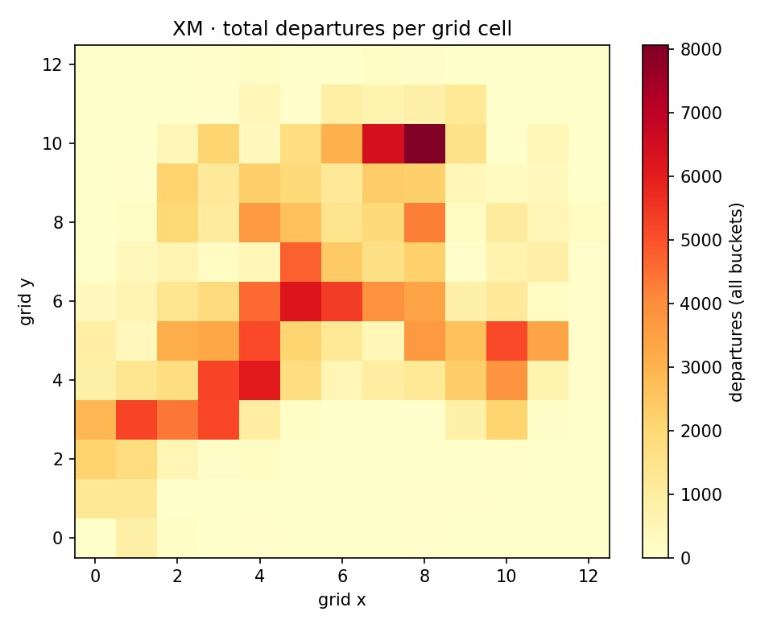
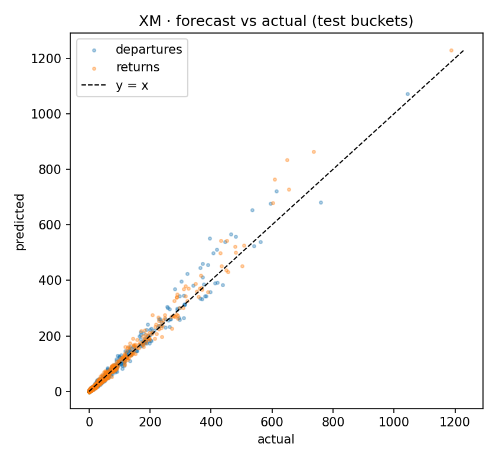
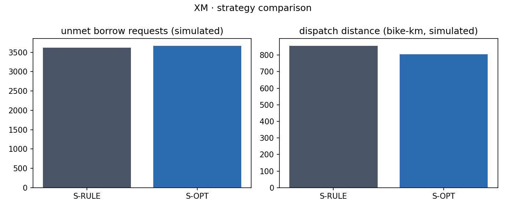
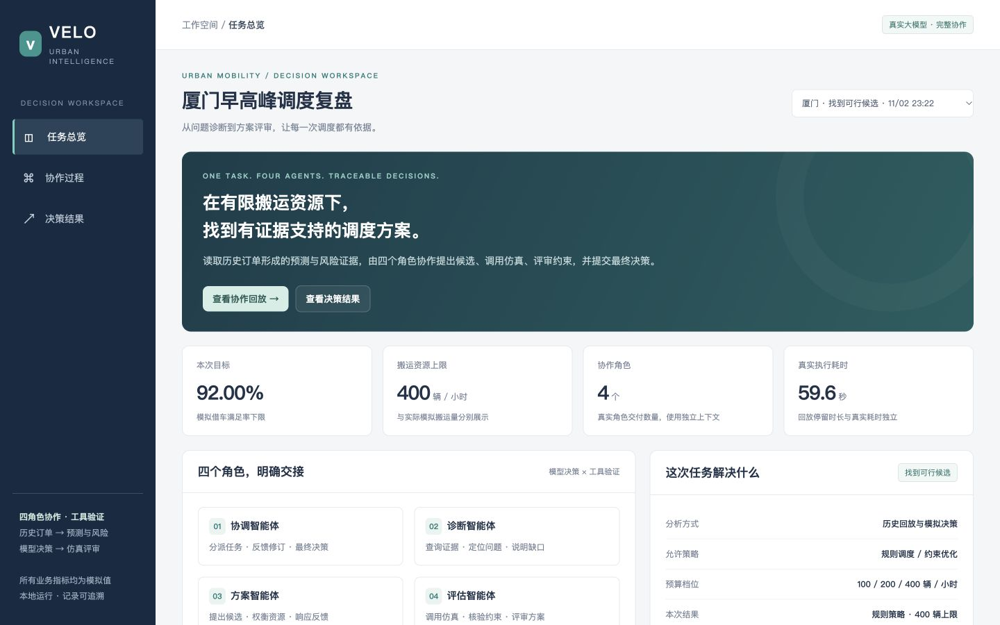
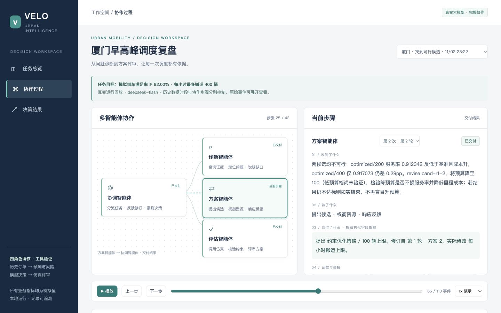
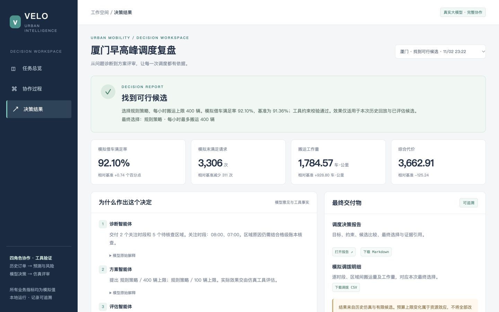

# 城市共享单车供需失衡预测与多智能体调度工作台 · 项目详细方案

- 代码仓库：<https://github.com/Jack11111eee/shared-bike-multi-agent-system>
- 在线演示：本机一键启动，见 [README 第 1 节](../README.md#1-启动在线演示)；
  启动后访问 `http://127.0.0.1:8000/console/`
- 版本：Phase 1–7（F1–F29），2026-11

---

## 第一章 项目概述

### 1.1 背景与问题

共享单车的供需失衡有两面：早高峰写字楼、地铁口持续缺车，居民区同时出现车辆堆积。
调度员面对的不是一个模型问题，而是一串互相牵制的问题：明天早上哪个格子会缺多少车？
该往哪里补、从哪里清？在有限的搬运能力下，先动哪一批？做完之后，怎么证明这个决定比
按经验调度更好？

项目把这条链路拆成可分别验证的五步：**接入 → 清洗聚合 → 预测 → 风险排序 → 调度仿真**，
再在其上增加两层：**可回放的空间过程**与**带证据的多智能体决策**。

### 1.2 项目目标

1. 用两个真实公开数据集证明方法可迁移，而不是只在一个城市上调参。
2. 所有中间结果落盘，任何报告里的数字都能追溯到具体产物文件。
3. 在同一份需求、库存、容量和预算下比较两种调度策略，差异只来自分配算法。
4. 让四个大模型角色在**受约束的工具集**里协作，程序负责校验与事实，模型负责判断与解释。
5. 演示站离线可运行：不联网、不调模型、不依赖构建步骤。

### 1.3 项目定位与范围

定位为**历史复盘与决策验证原型**：输入是历史订单，输出是模拟调度方案及其证据。
它不接入实时车辆状态，不做真实派单，也不声称运营收益。

范围内：数据接入、清洗、聚合、预测、风险清单、两种调度策略的仿真对比、回放站点、
规则驱动的多智能体闭环、DeepSeek 真实四角色运行、工作台发布、HTTP 只读接口、验收脚本。

范围外：实时在线调度、车辆路径规划、真实库存与真实损失订单、跨城市统一训练。

### 1.4 主要成果概览

| 类别 | 成果 |
|---|---|
| 数据 | 两个源统一到 9 字段订单契约；五条清洗规则；169/255 个网格格子 |
| 预测 | 季节均值基线 + LightGBM（Poisson），严格按时间切分 |
| 风险 | 可手工复算的三因子加权评分，输出补车 / 清运两张清单 |
| 仿真 | 规则调度与约束优化调度在同一回放下对比，逐格逐时间单元落盘 |
| 回放 | 离线站点：逐帧页、自动播放器、总览页、五章导览、差分地图、单格账本 |
| 多智能体 | 四角色协议、有界协作闭环、真实 DeepSeek 运行、候选独立空间产物 |
| 工作台 | 一次运行 = 一个可点击的回放，含任务总览 / 协作过程 / 决策结果三个视图 |
| 验收 | 470 项自动测试、确定性验收脚本、浏览器冒烟、审计摘要校验 |

### 1.5 交付与访问入口

| 入口 | 地址 |
|---|---|
| 代码仓库 | <https://github.com/Jack11111eee/shared-bike-multi-agent-system> |
| 在线演示 | 本机运行 `./start-demo.command`，访问 `http://127.0.0.1:8000/console/` |
| 离线回放站点 | 双击 `replay/index.html` |
| 决策报告 | `outputs/multi_agent/<run_id>/presentation/decision-report.html` |
| 使用说明 | `README.md`、`docs/phase7-usage.md` |

演示采用「本机启动」而不是公网托管，原因有三：调度数据与运行记录体积较大；地图在线底图
需要浏览器直接访问；真实模型调用不应由页面触发。读者按 README 一条命令即可复现同一页面。

---

## 第二章 需求与验收

### 2.1 功能需求

项目按七个阶段推进，每阶段有一份独立需求文档和验收条目（F 编号），共 29 项：

| 阶段 | 编号 | 核心内容 |
|---|---|---|
| Phase 1 | F1–F7 | 双源接入、清洗聚合、基线与模型、风险清单、策略对比、一键复现、三工具契约 |
| Phase 2 | F8–F11 | 逐格状态落盘、回放 HTTP 服务、离线回放界面、可审计规则智能体 |
| Phase 3 | F12–F15 | 自动播放器、可视化扩展、总览页、静态托管与时间轴接口 |
| Phase 4 | F16–F20 | 演示导览、关键事件跳转、差分地图、单格库存账本、敏感性场景切换 |
| Phase 5 | F21–F23 | 离线地理底图、预测联动、演示截图与录屏 |
| Phase 6 | F24–F29 | 四角色消息协议、有界协作闭环、工具与证据边界、运行入口与审计、协作展示、真实性与失败验收 |
| Phase 7 | — | 真实 DeepSeek 四角色决策、候选专属空间产物、交互工作台、在线/离线地图 |

### 2.2 非功能约束

- **可复现**：同一数据、同一配置、同一种子得到相同结果；原始数据只读，sha256 落盘。
- **可追溯**：报告中每个关键数字都能在 `outputs/key_numbers.json` 找到来源文件。
- **离线优先**：回放站点与工作台无外部请求；底图与 Leaflet 随包。
- **真实性**：规则运行不得标为大模型运行；失败运行保留，不改写为成功。
- **CPU 可跑**：不依赖 GPU，单机可完成全流程。
- **边界声明**：模拟值、有限候选、复盘而非在线预测，这三条必须出现在页面上。

### 2.3 验收方式

| 验收类型 | 手段 | 产物 |
|---|---|---|
| 单元与集成 | `pytest`（40 个测试模块） | `outputs/phase7_pytest.xml` |
| 阶段确定性验收 | `scripts/check_presentation.py`、`check_multi_agent.py`、`check_phase7.py` | `outputs/*validation*.json` |
| 浏览器联动 | `scripts/browser_smoke*.py`（真实 Chrome） | `outputs/*browser*.json` |
| 审计一致性 | 输入 manifest、候选产物、发布文件摘要逐项比对 | 运行目录内 `manifest.json` |

---

## 第三章 数据与预处理

### 3.1 数据来源

| 数据源 | 规模 | 时间覆盖 | 空间覆盖 | 许可 |
|---|---|---|---|---|
| DS-XM（厦门，Zenodo 17415891） | 220,675 行程 / 441,350 条锁状态记录 | 2020-12-21～12-25，06:00–10:00 | 14.7 × 13.8 km，密集 | 仅学术/教学，禁止商用，须署名 |
| DS-SH（上海 Mobike 样本） | 102,361 行程 | 2016-08-01～08-31 | 约 68 × 68 km，稀疏 | 公开仓库 |

两个源的字段、时间粒度、空间密度都不同，因此适配器只负责把原始记录转成同一个订单契约
（`trip_id / bike_id / start_time / end_time / start_lat / start_lng / end_lat / end_lng / duration_s`），
下游所有阶段不再出现源专属字段。

### 3.2 清洗规则

五条规则逐条计数，任何一条被删掉的行都有原因记录：

| 规则 | XM 移除行数 | 说明 |
|---|---:|---|
| 重复 trip_id | 0 | 同一编号只保留首次出现 |
| 缺失坐标 | 0 | 起点或终点经纬度缺失 |
| 异常时长 | 6,310 | 不在 [60s, 21600s] 内 |
| 越界坐标 | 6,765 | 超出 0.5%–99.5% 坐标包络 |
| 起终点相同伪行程 | 11,918 | 两点距离小于 50 m |

XM 输入 220,675 行，保留 195,682 行，移除 11.33%。

### 3.3 空间与时间单元

- **空间**：以米为单位的规则网格，从清洗后的坐标包络推导。XM 为 1000 m（13 × 13，有效 169 格），
  SH 为 2000 m（255 格）。用米而不是经纬度度数，避免高纬度格子被压扁。
- **时间**：1 小时一个时间桶，产出完整的「格子 × 时间」面板，**零值也落盘**，
  否则零借出会被误当成缺失。



### 3.4 数据许可

原始数据不入库，由 `bike-agent repro` 下载并校验；`data/raw/manifest.json` 记录 sha256。
所有分析均为聚合级别，不产出可识别个体的结果。

---

## 第四章 方法与实现

### 4.1 短期需求预测

**任务**：给定历史面板，预测下一时间单元每个格子的借出量与归还量。

**两条路线**：

- 基线：格子 × 小时的训练集均值；没有历史时回退到格子均值，再回退到全局均值。
- 模型：LightGBM，Poisson 目标，特征包括小时、星期、是否周末、时间间隔、上一小时滞后、
  近三桶滚动量、格子均值、格子 × 小时均值。

**切分**：严格按时间顺序，前 80% 训练、后 20% 测试，不做随机切分。

**结果**（详见第六章）：XM 上模型未显著优于基线（训练仅 16 个时间桶）；
SH 上模型在两个目标上均显著更优（n = 37,995）。报告同时披露了评估口径差异：
模型使用了上一时间桶的实际观测值（一步预测），基线没有。

### 4.2 失衡风险评分

风险分三因子加权，公式写在报告里，可以手工复算：

```text
net        = pred_out - pred_in
magnitude  = |net|
demand     = pred_out + pred_in
volatility = std(net) over training buckets
score      = 0.60 * magnitude/max(magnitude)
           + 0.25 * demand/max(demand)
           + 0.15 * volatility/max(volatility)
```

权重来自决策记录 D7：净流出幅度直接决定调度动作，权重最高；需求规模次之；
历史波动受样本长度限制，权重最低。`pred_net_flow > 0` 归入优先补车清单，
`< 0` 归入优先清运清单。CSV 每行带 `mag_norm / demand_norm / vol_norm`，可代入公式核对。

时间桶取「观测借还总量不低于峰值 10% 的最后一个时间桶」，避免把跨夜空桶当成调度目标。

### 4.3 调度仿真

**事件顺序**（每个时间单元）：先执行上一轮决定的搬运，再依次处理归还与借车请求，
最后记录库存并计算指标。顺序固定，两种策略一致。

**两个策略**：

- S-RULE：按风险分排序的贪心搬运，优先补净流出最大的格子。
- S-OPT：以最小费用流求解供需匹配，在预算与容量约束下最小化未满足与距离的加权代价。

**公平性**：两策略共享同一份预测、同一份历史需求、同一套库存与容量、同一个预算，
唯一不同的变量是分配算法。综合代价 = 未满足请求数 × 1.0 + 搬运距离 × 0.2。

**约束检查**：守恒、容量、预算、负库存、搬运截断五项违规逐桶计数，必须全为零。

**敏感性**：七个已计算场景（初始库存 0.3/0.7、预算 100/400、容量 0.5×/2×），
场景只更新汇总表，不生成空间回放。

### 4.4 统计显著性

策略差异用配对差与 bootstrap 置信区间判断，不只报点估计。
XM 只有 4 个时间单元（n=4），置信区间很宽，因此结论明确写成「不显著」；
SH 有 149 个时间单元，优化策略的综合代价显著更低。显著性图见
`figures/significance.png`。

### 4.5 回放与可视化

- **逐帧页**：每个时间单元一页，两种策略并排；帧数严格等于产物时间单元数（XM 4 帧 / SH 149 帧），
  不插值、不补帧。
- **播放器**：自动播放、暂停、上一帧/下一帧、拖动、0.5×–4× 变速、循环；
  动画只改变停留时间，不改变数据。
- **复盘工作台**：五章导览、关键事件跳转、差分地图（`delta_unmet = 优化 − 规则`，负值表示优化更少未满足）、
  单格库存账本、场景切换。
- **地理底图**：GSHHG 海岸线与 OSM 水系/行政界随包，离线可用；两源坐标按 WGS-84 直接叠加，
  坐标证据见 `docs/crs-evidence.md`。

### 4.6 多智能体决策

四个角色各有独立上下文与工具权限，职责互斥：

| 角色 | 职责 | 可用工具 |
|---|---|---|
| coordinator | 下发任务、审阅评估、决定修订或终结 | 无（不计算指标） |
| diagnosis | 从基准轨迹找最差时段与关注格 | `get_forecast`、`get_risk_ranking` |
| dispatch | 提出或修订候选（策略 × 预算） | 无 |
| evaluation | 运行候选、建立基准、计算差值 | `evaluate_dispatch_candidate` |

**协作闭环**：基准 → 诊断 → 提案 → 评估 → 拒绝 → 修订 → 重评估 → 终态。
协调角色只能从 `allowed_actions` 里选动作，`finalize` 的候选必须已评估且可行；
修订只能改策略或预算两个参数，不能凭空要求引擎做它不支持的动作。

**程序与模型的分工**：模型决定诊断方向、候选组合、评审意见和下一步；
仿真引擎产生具体搬运记录；程序校验参数、预算、输入冻结、五项违规与结果身份。
模型文字与工具事实分开保存，页面上明确标注「模型原始解释，数值以工具事实为准」。

**终态**：`accepted`（可行候选严格优于可行基准）、`baseline_retained`（保留基准）、
`no_feasible_candidate`（没有可行方案）、`failed`（协议/工具/输入错误）、
`limit_reached`（轮次或工具调用用尽）。「保留基准」不会被说成「优化获胜」。

---

## 第五章 系统架构

### 5.1 分层

```text
数据源         Zenodo DS-XM  /  GitHub DS-SH
   ↓
接入层         data/xm.py, data/sh.py → 统一订单契约 → 完整性报告
   ↓
清洗聚合层     prep/clean.py → prep/grid.py → 完整面板（含零值）
   ↓
分析层         forecast/（基线 + LightGBM）   risk/（三因子评分）
   ↓
仿真层         sim/engine.py + strategies.py → 逐格逐时轨迹 + 五项约束
   ↓
决策层         multi_agent/（协议、网关、运行时、审计）→ 候选产物 + 决策
   ↓
展示层         replay/（逐帧、播放器、工作台）  presentation/（工作台、报告）
   ↓
服务层         serve/app.py（静态托管 + 只读 API）
```

### 5.2 模块与职责

| 目录 | 职责 | 关键约束 |
|---|---|---|
| `bike_agent/data/` | 两个适配器与统一契约 | 下游只看契约字段 |
| `bike_agent/prep/` | 清洗计数、米制网格、零值面板 | 守恒可核对 |
| `bike_agent/forecast/` | 时间切分、基线、模型、评估 | 禁止随机切分 |
| `bike_agent/risk/` | 可解释评分与两张清单 | 公式可手工复算 |
| `bike_agent/sim/` | 回放引擎、两种策略 | 两策略共享全部输入 |
| `bike_agent/report/` | 报告文本与图表 | 数字来自产物 |
| `bike_agent/replay/` | 静态站点渲染 | 帧数 = 时间单元数 |
| `bike_agent/presentation/` | 工作台、协作页、只读视图模型 | 不调用模型、不替换结果 |
| `bike_agent/multi_agent/` | 协议、网关、运行时、审计 | 越权与悬空引用在工具执行前拒绝 |
| `bike_agent/llm/` | Provider 接口与 DeepSeek 适配 | 离线路径不 import SDK |
| `bike_agent/serve/` | HTTP 只读服务 | 标准库实现，可离线启动 |

### 5.3 数据流

```text
原始数据 → 契约 → 清洗 → 面板 → 预测 ─┐
                                    ├→ 仿真 → 轨迹 → 回放站点
                      风险清单 ─────┘
                                    └→ 多智能体（工具调用）→ 审计目录 → 工作台
```

一次大模型运行的目录结构（只增不改）：

```text
outputs/multi_agent/<run_id>/
├── task.json               冻结的任务目标与约束
├── input_manifest.json     六个必需输入 + 三个可选输入的 sha256
├── execution_config.json   模型身份、调用限制、提示词摘要（无密钥）
├── model_calls.jsonl       每次模型请求与响应摘要
├── model_io/               原始提示与响应（本地保留）
├── messages.jsonl          角色交付与证据引用
├── tool_calls.jsonl        工具调用与返回事实
├── checks.jsonl            程序校验结果
├── events.v2.jsonl         按发生顺序的事件
├── artifacts/<id>/         候选独立的空间结果
├── decision.json / run.json 终态、选择与耗时
└── presentation/           独立可打开的页面、报告、CSV、manifest
```

### 5.4 接口契约

旧 F7 三工具（`get_forecast` / `get_risk_ranking` / `run_simulation`）的 schema 与返回结构保持不变；
Phase 6 新增版本化契约 `evaluate_dispatch_candidate`（`schema_version: "1.0"`），
它是 `run_simulation(..., write=False)` 的薄封装，同参数下四项指标逐值一致，
并把引擎产生的五个违规计数原样透出。

HTTP 层：

| 接口 | 能力 |
|---|---|
| `GET /` | 托管 `replay/` 静态站点 |
| `GET /api/sources` | 数据源、网格规模、时间范围 |
| `GET /api/replay/index`、`/frame`、`/timeline` | 时间轴、单帧、播放器数据 |
| `GET /api/tools/forecast`、`/risk`；`POST /api/tools/simulate` | 三工具契约 |
| `GET /api/v2/runs`、`/runs/<id>`、`/events`、`/candidates/<id>`、`/results/<id>/spatial`、`/report` | 运行记录只读访问 |

静态托管只读，只允许 html/css/js/png/svg/json/txt/ico；路径穿越返回 4xx。

---

## 第六章 最终成果

### 6.1 数据与预测

| 指标 | DS-XM | DS-SH |
|---|---|---|
| 行程数 | 220,675 | 102,361 |
| 清洗后保留 | 195,682（88.67%） | — |
| 网格格子数 | 169 | 255 |
| 时间桶数 | 20 | 743 |
| 零借出占比 | 29.76% | 76.39% |
| 基线 MAE（借出） | 7.0754 | 0.5336 |
| 模型 MAE（借出） | 7.3755 | 0.5103 |
| 基线 MAE（归还） | 6.9712 | 0.5396 |
| 模型 MAE（归还） | 6.7322 | 0.5129 |

结论：XM 上模型与基线无显著差异（训练仅 16 个时间桶）；SH 上模型在两个目标上均显著更优。
这一分化本身就是结果——方法可迁移，但小样本下树模型无法稳定获益。



### 6.2 策略对比

| 指标 | XM S-RULE | XM S-OPT | SH S-RULE | SH S-OPT |
|---|---:|---:|---:|---:|
| 未满足请求 | 3,617 | 3,669 | 181 | 170 |
| 搬运距离（bike-km） | 855.77 | 804.38 | 3,559.42 | 3,547.09 |
| 综合代价 | 3,788.15 | 3,829.88 | 892.88 | 879.42 |
| 服务率 | 91.36% | 91.23% | — | — |

- XM：优化策略综合代价点估计高 1.10%，但 95% CI [-268.47, +371.98]，**不显著**。
- SH：优化策略综合代价显著更低，95% CI [-25.31, -1.08]。
- 两个源的五项违规计数全部为零。



### 6.3 多智能体运行

主演示运行 `20261102T152230044850Z-xm-llm-a4feea`：

| 项目 | 值 |
|---|---|
| 模式 / 真实性 | `llm` / `real_model_complete` |
| 角色 | 协调、诊断、方案、评估（均有真实模型响应） |
| 轮次 / 候选 | 3 轮 / 6 个独立候选 |
| 模型请求 / 工具调用 | 22 / 9 |
| 总耗时 | 约 59.6 秒 |
| 终态 | `accepted`，选择 rule / 400 |

| 指标 | 基准 rule/200 | 最终 rule/400 | 变化 |
|---|---:|---:|---:|
| 模拟满足率 | 91.36% | 92.10% | +0.74 pp |
| 未满足请求 | 3,617 | 3,306 | −311 |
| 搬运工作量（车·公里） | 855.77 | 1,784.57 | +928.80 |
| 综合代价 | 3,788.15 | 3,662.91 | −125.24 |

页面上同时写明：预算上限从 200 提到 400，改善中包含资源效应，不能全部归因于算法；
这是有限候选、冻结假设下的历史仿真，不是真实运营收益。

工作台保留的其余真实终态：`baseline_retained`（默认上限）、
`no_feasible_candidate`（高约束）、`failed`（开发期失败）。失败记录可查看，但不计作模型可靠性。







### 6.4 演示站点

| 页面 | 内容 |
|---|---|
| `console/index.html` | 任务总览、协作过程、决策结果三视图；候选表、空间结果、区域账本 |
| `replay/index.html` | 站点首页与入口导航 |
| `replay/dashboard.html` | 关键数字、两源对照、策略对比、全部图表 |
| `replay/<source>/player.html` | 自动播放器 |
| `replay/<source>/workbench.html` | 五章导览、关键事件、差分地图、单格账本、场景切换 |
| `replay/collab.html` | 由真实运行记录生成的协作时间线 |

所有页面无外部请求，`file://` 直接可读；打开页面不会触发模型或仿真。

---

## 第七章 效果验证

### 7.1 自动测试

`python3 -m pytest` 覆盖接入契约、清洗规则、面板守恒、预测切分、风险公式、仿真约束、
回放帧数、播放器数据、工作台状态、多智能体协议、工具权限、审计与发布。
最近一次全量结果为 **470 项通过，0 失败、0 错误、0 跳过**（`outputs/phase7_pytest.xml`）。

### 7.2 确定性验收

| 脚本 | 检查内容 | 产物 |
|---|---|---|
| `scripts/check_presentation.py --phase 4/5` | 导览、事件、差分、账本、场景、底图、预测联动 | `outputs/presentation_validation.phase*.json` |
| `scripts/check_multi_agent.py` | 协议、终态、符号、审计、离线页 | `outputs/multi_agent_validation.phase6.json` |
| `scripts/check_phase7.py --run-id …` | 真实性、产物身份、导出与发布 | `outputs/phase7_validation.json` |

Phase 7 主运行 25 项检查全部通过，包括：四个角色均有真实模型证据、事件序号单调、
每个候选的空间产物总量与汇总一致、选中候选可行、发布文件摘要与当前 UI 一致。

### 7.3 浏览器与人工检查

- `scripts/browser_smoke.py`：量测渲染结果，差分格必须有正的宽高，
  账本的期末库存必须能由页面上的操作数算回，`data-join-key` 必须指向当前时段。
- `scripts/browser_smoke_multi_agent.py`：协作页深链与运行隔离。
- `outputs/phase7_browser_checks.json`：同名候选跨运行正确隔离、回放起点不提前显示未来结果、
  1440/1366/500 像素宽度无横向溢出、在线与离线地图使用同一个 `result_id`。

### 7.4 可追溯性

`outputs/key_numbers.json` 把报告里的每个关键数字映射到来源文件；
运行目录的 `input_manifest.json` 在工具调用前后各校验一次输入摘要，
输入变化即失败，不会用旧结果冒充新运行；发布目录的 `manifest.json` 记录页面资源摘要，
改一行页面代码再交付旧截图，验收脚本会直接报「素材已过期」。

### 7.5 结果边界（必须同时说明）

- 所有调度指标为模拟值，未满足请求不等于实测缺车或真实损失订单。
- XM 只有 4 个可回放时间单元，统计结论的样本量很小；SH 服务率约 99%，多数帧搬运量只有个位数。
- 大模型运行在有限候选空间内决策，不声称全局最优。
- 诊断读取的是基准历史回放，属于复盘辅助，不是无未来信息的在线预测实验。

---

## 第八章 AI 编程工具与协作过程

### 8.1 使用的工具

项目使用 **[CC]** 与 **Codex** 作为主要编程工具，两者承担不同层次的写作：

| 工具 | 主要用途 |
|---|---|
| [CC] | 需求拆解、跨文件改造、验收脚本、页面与文档；在本项目中还承担了阶段性的自动执行循环 |
| Codex | 局部代码补全、函数级实现建议、失败用例的定位与修改建议 |

模型只参与**写代码与写文档**，不参与运行时的业务判断（唯一的运行时模型调用是 Phase 7
的四角色协作，且由显式命令触发）。

### 8.2 通过需求描述驱动实现

每个阶段先写需求文档（`REQUIREMENTS.md`、`REQUIREMENTS-PHASE2.md` … `PHASE6`），
把「做什么」拆成带编号的验收条目，例如：

- `F5-5`：两种策略必须共享同一份预测与存量，差异只来自分配算法；
- `F9`：回放服务是薄封装，不允许重新计算；
- `F29`：终态必须可区分，数字必须可追溯，不得伪造 LLM 参与或收益。

条目写成**可检查的句子**，实现时直接对应到测试或验收脚本。需求变更不直接改代码，
而是先在文档里记录修订原因（`DECISIONS.md` 的「与上一阶段的冲突修订」各节即为此）。

### 8.3 调试与修改的工作方式

1. **先复现，再修改**：每个问题先写一个最小复现（测试或脚本），确认失败原因，
   修改后让同一个复现转绿。
2. **确定性验收兜底**：页面类功能不靠肉眼确认，`check_*.py` 把状态、帧数、符号、
   账本操作数写成断言；浏览器冒烟量测元素尺寸，防止「元素存在但尺寸为零」蒙混过关。
3. **保留失败证据**：运行失败也写审计目录；测试夹具的运行不发布、不列入真实运行列表。
4. **记录取舍**：`DECISIONS.md` 记录 D1–D30，包括被放弃的方案与原因，
   避免后续重复讨论同一问题。
5. **降级而不是假装成功**：缺少 Chrome 时浏览器冒烟返回 3 并报告「未验证」；
   缺少媒体工具时导出命令明确失败，不产出空文件或占位图。

一个具体的例子：Phase 4 的差分地图曾出现「页面正常但地图空白」。原因是预渲染页面
与运行时重渲染用了两套逻辑，四个自动检查都通过，因为它们检查的是数据而不是渲染结果。
修复方式不是加断言，而是**收敛成一份渲染器**，并让浏览器冒烟量测格子的实际像素尺寸。
这条经验后来写进了阶段验收清单。

### 8.4 经验与边界

- AI 工具最有效的场景是**有明确验收标准**的改造；需求写得含糊时，生成结果也会含糊。
- 对抗「看起来能跑」的假象，靠的是确定性脚本和真实浏览器，而不是再问一次模型。
- 涉及统计结论时，必须让人来判断口径（例如 XM 的 n=4），模型只负责实现计算。
- 所有 AI 生成的代码都要经过测试与验收；文档中的数字必须能指向产物文件。

---

## 第九章 改进方向

| 方向 | 当前状态 | 后续措施 |
|---|---|---|
| 预测样本不足 | XM 训练仅 16 个时间桶 | 争取更长时间覆盖的数据；滚动评估；分层模型 |
| 评估口径 | 模型为一步预测，基线为同期均值 | 统一为一步或改为多步递归预测后重测 |
| 策略收益 | XM 上两策略差异不显著 | 扩大时间覆盖；引入真实库存与容量标定 |
| 候选空间 | 仅「策略 × 预算」组合 | 增加格级重定向、分时段预算；扩展引擎动作空间 |
| 在线能力 | 只读接口，运行由 CLI 触发 | 浏览器创建任务、实时事件流、取消接口 |
| 地图 | 离线底图已可用 | 高德安全码配置；更多城市底图 |
| 移动端 | 未实现 | 现场接单与反馈页面 |
| 演示环境 | 本机启动 | 可选静态托管与只读 API 部署 |

近期优先补齐「预测口径统一」与「更长时间覆盖的复测」，因为它们直接影响现有结论的强度；
其余方向按演示与教学需要逐步推进。

---

## 附录 A 常用命令

```bash
python3 -m pip install -e .
bike-agent repro --fresh                 # 从零复现全部产物
bike-agent serve --port 8000             # 本地演示服务
bike-agent multi-agent --source xm       # 规则驱动四角色协作
bike-agent multi-agent --mode llm --source xm --max-budget 400 --min-service-rate 0.92
bike-agent console publish --run-id <run_id>
python3 -m pytest
python3 scripts/check_phase7.py
```

## 附录 B 术语

| 术语 | 含义 |
|---|---|
| 时间桶 | 1 小时的时间单元 |
| 格子 | 规则网格中的一个空间单元，XM 1000 m，SH 2000 m |
| S-RULE / S-OPT | 规则贪心调度 / 约束优化调度 |
| 未满足请求 | 回放中因库存不足无法满足的借车请求（模拟值） |
| 综合代价 | 未满足请求数 × 1.0 + 搬运距离 × 0.2 |
| 终态 | 一次多智能体运行的结束状态：accepted / baseline_retained / no_feasible_candidate / failed / limit_reached |
| 真实性标签 | 区分真实模型运行、规则运行与测试夹具运行的标记 |
